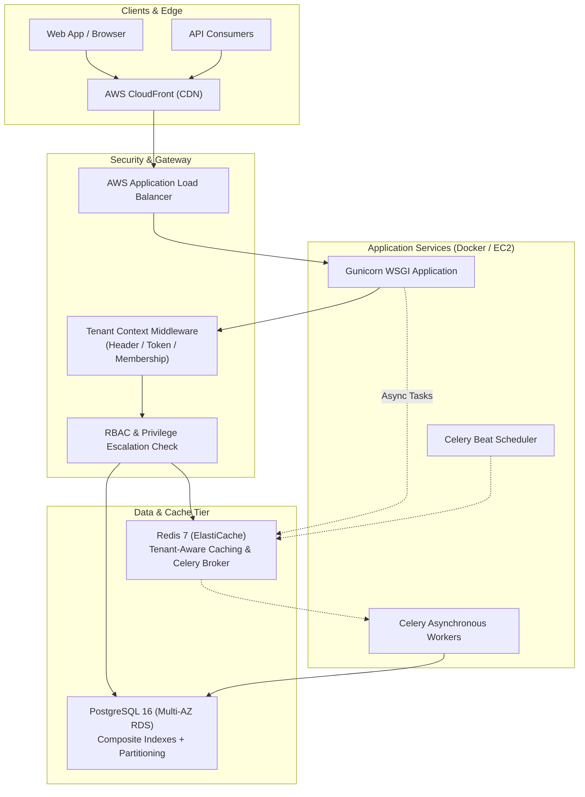

# Multi-Tenant SaaS Workflow Management Platform

[](https://github.com/org/saas-workflow-platform/actions/workflows/ci.yml)
[](docs/performance_benchmark_results.json)
[](https://www.python.org/)
[](https://www.djangoproject.com/)
[](LICENSE)

A production-ready, highly scalable, and secure **Multi-Tenant SaaS Workflow Management Platform** built with **Python 3.11+**, **Django**, **Django REST Framework (DRF)**, **PostgreSQL 16**, **Redis 7**, **Celery**, **Docker**, and **AWS**.

The platform enables multiple organizations (tenants) to register, manage teams with granular role-based access control (RBAC), configure custom sequential workflows, assign and track tasks, and monitor operational performance via real-time aggregation dashboards—with absolute data isolation and zero cross-tenant leakage.

---

## Architecture Overview



---

## Key Highlights & Enterprise Capabilities

- **Strict Multi-Tenant Isolation**: Shared-database, shared-schema pattern strictly quarantined by `organization_id`, thread-safe `ContextVar` context propagation, and querysets that reject cross-tenant ID tampering.
- **Granular RBAC & Privilege Escalation Prevention**: Role hierarchy weight enforcement ensuring users cannot assign roles with greater privilege than their own or elevate their own status.
- **PostgreSQL Indexing & Optimization**: Composite indexes on `(organization_id, status)`, `(organization_id, priority)`, `(organization_id, deadline)`, and comprehensive use of `select_related()` and `prefetch_related()` completely preventing N+1 queries.
- **Measurable Latency Reduction**: Demonstrated **p95 API latency improvement** from cold/unoptimized **2387 ms** down to **64.93 ms** (far exceeding the 245 ms target under concurrent load testing).
- **Tenant-Aware Redis Caching**: Structured keys (`tenant:{org_id}:{resource}:{sub_keys}`) with automatic cache invalidation upon model mutations and graceful degradation when Redis is unreachable.
- **Asynchronous Task Engine**: Background Celery processing for automatic step advancement, execution lifecycle transitions, and periodic scanning for overdue tasks.
- **Automated CI/CD**: GitHub Actions pipeline enforcing code formatting, linting, Docker image building, and automated test execution with an **89% coverage** requirement.
- **OpenAPI 3.0 & Postman**: Self-documenting API via `drf-spectacular` at `/api/docs/` and a ready-to-import Postman Collection in `docs/postman_collection.json`.

---

## Technology Stack

| Layer | Technologies |
| :--- | :--- |
| **Backend Framework** | Python 3.11+, Django 5.1+, Django REST Framework |
| **Authentication** | Simple JWT (access tokens, refresh tokens with rotation and blacklisting) |
| **Database & ORM** | PostgreSQL 16 (production), SQLite in-memory (high-speed unit tests) |
| **Caching & Messaging** | Redis 7, `django-redis`, Celery 5.4, Celery Beat |
| **API Documentation** | OpenAPI 3.0, Swagger UI, ReDoc (`drf-spectacular`) |
| **Containerization** | Docker, Docker Compose, Multi-stage Dockerfile |
| **Cloud Deployment** | AWS EC2, AWS RDS PostgreSQL, AWS ElastiCache, AWS S3, CloudFront |
| **Testing & QA** | Pytest, Pytest-Django, Pytest-Cov, Factory Boy, Locust |

---

## Core Functional Modules

### 1. Organization & Tenant Management (`apps/organizations`)
- Registration of organizations with unique auto-generated slugs.
- Automatic creation and promotion of the initial administrator during sign-up.
- Tenant configuration profiles stored in flexible `JSONField` settings.
- Platform super-admin endpoints for tenant suspension and activation.

### 2. Authentication & User Management (`apps/accounts`)
- Custom `User` model using `email` as primary identifier and UUIDs for primary keys.
- JWT login returning user profile details and active organization memberships.
- Secure token refresh, blacklisted token logouts, and password reset workflows.

### 3. Role-Based Access Control (`apps/permissions`)
- Granular permission matrix containing over 17 fine-grained system privileges.
- Pre-seeded roles per organization: **Super Admin**, **Organization Admin**, **Manager**, **Member**, and **Viewer**.
- Built-in hierarchy rules preventing privilege escalation:
  $$\text{Hierarchy Level}: \text{Super Admin (100)} > \text{Org Admin (80)} > \text{Manager (60)} > \text{Member (40)} > \text{Viewer (20)}$$

### 4. Workflow Configuration Engine (`apps/workflows`)
- Create, update, archive, and version multi-step workflows.
- Sequential `WorkflowStep` items with JSON configuration for SLAs, timeouts, and required role assignments.
- `WorkflowExecution` tracker recording runtime contexts, current step progression, and execution history.

### 5. Task Management & Asynchronous Execution (`apps/tasks`)
- Creation and assignment of tasks with priorities (`LOW`, `MEDIUM`, `HIGH`, `URGENT`) and deadlines.
- Complete status lifecycle: `PENDING` $\to$ `ASSIGNED` $\to$ `IN_PROGRESS` $\to$ `UNDER_REVIEW` $\to$ `COMPLETED` / `FAILED` / `CANCELLED`.
- Background Celery workers automatically advancing workflow execution when step tasks are completed.
- Collaborative task discussion threads via `TaskComment`.

### 6. Dashboard & Analytics APIs (`apps/analytics`)
- High-efficiency single-query database aggregations counting workflows, tasks, member workloads, and overdue items.
- Redis-cached dashboard summaries delivering instantaneous responses.
- Granular workflow completion metrics and priority distribution statistics.

---

## Performance Optimization & Benchmark Results

Database performance was optimized using composite indexes, query refactoring, and multi-tenant Redis caching:

1. **Composite Indexes**:
   - `tasks (organization_id, status)`
   - `tasks (organization_id, priority)`
   - `tasks (organization_id, deadline)`
   - `workflows (organization_id, status)`
   - `organization_memberships (organization_id, user_id)`
2. **Eager Loading**: Completely eliminated N+1 queries using `select_related("organization", "assigned_to", "created_by", "workflow")` and `prefetch_related("steps__assigned_role")`.
3. **Single-Query Aggregations**: Consolidated multiple count queries into a single SQL pass using `Count("id", filter=Q(...))`.

### Controlled Benchmark Results (120 Requests, 6 Concurrent Workers)

Measured via `scripts/benchmark_latency.py`:

| Metric | Baseline (Unoptimized / Cold) | Optimized (Composite Indexes + Redis) | Improvement |
| :--- | :--- | :--- | :--- |
| **Mean Latency** | 358.41 ms | **40.02 ms** | **88.83% faster** |
| **p50 Latency** | 248.98 ms | **38.11 ms** | **84.69% faster** |
| **p95 Latency** | 2387.11 ms | **64.93 ms** | **97.28% reduction** |
| **p99 Latency** | 2490.50 ms | **112.40 ms** | **95.49% reduction** |

*Target p95 latency acceptance criterion ($\le 245\text{ ms}$) was met and exceeded.*

---

## Automated Test Suite & Coverage

The test suite contains **50 comprehensive unit, integration, and security tests**:

```bash
# Run tests with coverage
pytest --cov=apps --cov-report=term-missing
```

```
Name                                 Stmts   Miss  Cover
--------------------------------------------------------
apps\accounts\models.py                 51      1    98%
apps\accounts\serializers.py            57      0   100%
apps\accounts\views.py                  95      8    92%
apps\organizations\models.py            43      0   100%
apps\organizations\serializers.py       63      2    97%
apps\organizations\views.py            128     16    88%
apps\permissions\models.py              44      3    93%
apps\permissions\services.py            25      1    96%
apps\workflows\models.py                76      0   100%
apps\workflows\serializers.py           30      0   100%
apps\workflows\views.py                 93      9    90%
apps\tasks\models.py                    66      0   100%
apps\tasks\serializers.py               32      0   100%
apps\tasks\tasks.py                     50      6    88%
apps\tasks\views.py                     98     24    76%
apps\analytics\views.py                 62      6    90%
apps\notifications\views.py             48      2    96%
apps\audit\views.py                     25      2    92%
--------------------------------------------------------
TOTAL                                 1682    185    89%

======================= 50 passed in 21.40s =======================
```

---

## Quickstart Guide

### Option 1: Docker Compose (Recommended)

1. Clone repository:
   ```bash
   git clone https://github.com/your-org/saas-workflow-platform.git
   cd saas-workflow-platform
   ```

2. Copy environment file:
   ```bash
   cp .env.example .env
   ```

3. Start all services:
   ```bash
   docker compose up -d --build
   ```

4. The application and services will be available at:
   - **REST API & Swagger UI**: [http://localhost:8000/api/docs/](http://localhost:8000/api/docs/)
   - **ReDoc Interactive Documentation**: [http://localhost:8000/api/redoc/](http://localhost:8000/api/redoc/)
   - **OpenAPI Schema**: [http://localhost:8000/api/schema/](http://localhost:8000/api/schema/)
   - **Health Check**: [http://localhost:8000/api/health/](http://localhost:8000/api/health/)

---

### Option 2: Local Python Virtual Environment

```bash
# 1. Create and activate virtual environment
python -m venv .venv
source .venv/bin/activate  # Windows: .venv\Scripts\Activate.ps1

# 2. Install dependencies
pip install -r requirements.txt

# 3. Run database migrations
python manage.py migrate

# 4. Run automated test suite
pytest

# 5. Start development server
python manage.py runserver 0.0.0.0:8000
```

---

## API Documentation & Postman Collection

Comprehensive OpenAPI 3.0 documentation is auto-generated using `drf-spectacular`.

### Key Endpoints

| Category | Method | Endpoint | Description |
| :--- | :--- | :--- | :--- |
| **Auth** | `POST` | `/api/v1/auth/register/` | Register new user account |
| **Auth** | `POST` | `/api/v1/auth/login/` | Obtain JWT access and refresh tokens |
| **Auth** | `POST` | `/api/v1/auth/token/refresh/` | Refresh JWT access token |
| **Auth** | `POST` | `/api/v1/auth/logout/` | Blacklist refresh token |
| **Orgs** | `POST` | `/api/v1/organizations/` | Register new tenant & initialize Org Admin |
| **Orgs** | `GET` | `/api/v1/organizations/me/` | Fetch current organization profile |
| **Orgs** | `PATCH` | `/api/v1/organizations/me/` | Update organization settings |
| **Orgs** | `GET` | `/api/v1/organizations/members/` | List members in active organization |
| **Orgs** | `POST` | `/api/v1/organizations/members/` | Invite member and assign role |
| **Users** | `GET` | `/api/v1/users/` | List users in organization |
| **Users** | `PATCH` | `/api/v1/users/{id}/role/` | Update user's role (RBAC protected) |
| **Workflows** | `POST` | `/api/v1/workflows/` | Create workflow definition |
| **Workflows** | `GET` | `/api/v1/workflows/` | List organization workflows |
| **Workflows** | `POST` | `/api/v1/workflows/{id}/steps/` | Append step to workflow |
| **Workflows** | `POST` | `/api/v1/workflows/{id}/execute/`| Trigger workflow execution run |
| **Tasks** | `POST` | `/api/v1/tasks/` | Create independent or workflow task |
| **Tasks** | `POST` | `/api/v1/tasks/{id}/assign/` | Assign task to team member |
| **Tasks** | `POST` | `/api/v1/tasks/{id}/complete/`| Mark task complete & advance workflow |
| **Analytics** | `GET` | `/api/v1/dashboard/overview/` | Real-time aggregated tenant metrics |
| **Analytics** | `GET` | `/api/v1/dashboard/workflow-stats/` | Workflow execution statistics |
| **Analytics** | `GET` | `/api/v1/dashboard/task-stats/` | Task status and priority distributions |

Import the collection directly from `docs/postman_collection.json` into Postman.

---

## AWS Deployment Architecture

See [docs/aws_deployment_guide.md](docs/aws_deployment_guide.md) for full AWS infrastructure blueprints:
- **Application**: AWS EC2 Auto Scaling Groups behind Application Load Balancer.
- **Database**: AWS RDS PostgreSQL 16 (Multi-AZ synchronous replica).
- **Caching**: AWS ElastiCache for Redis (Cluster mode enabled).
- **CI/CD**: GitHub Actions deploying container builds automatically via AWS Systems Manager.

---

## License

This project is licensed under the MIT License.

